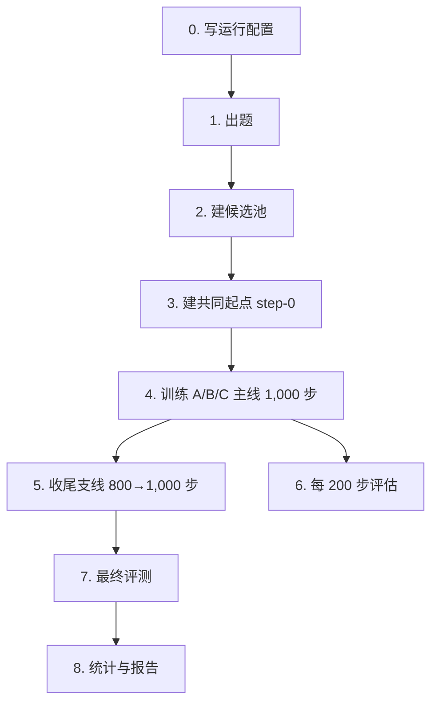

# 历史精修实验：训练与评估流程

日期：2026-11-21　适用：中等规模（1,000 道训练题 + 200 道验证题）；正式规模只是参数不同。

本文按执行顺序，写清楚每一步做什么、用什么、产出什么。评测和比较的规则以 [正式实验规则.md](正式实验规则.md) 为准，本文不重复规则的理由，只引用节号。实验背景见 [设计.md](设计.md)。

每一步都标了**实现状态**：

- ✅ 已实现：现有代码能直接做到，试跑中已经跑过。
- 🔧 要修改：现有代码能做一部分，要改了才符合规则。
- ⬜ 要新写：现有代码没有这一步。

---

## 总览



| 步骤 | 大约耗时（本机） | 实现状态 |
|---|---|---|
| 0. 写运行配置 | — | ⬜ |
| 1. 出题 | 几分钟 | ✅ |
| 2. 建候选池 | 约 3.4 小时 | ✅ |
| 3. 建共同起点 | 几分钟 | ✅ |
| 4. 训练主线 | 约 5 小时 | 🔧 |
| 5. 收尾支线 | 约 1 小时 | ⬜ |
| 6. 每 200 步评估 | 约 1 小时 | 🔧 |
| 7. 最终评测 | 约 9–11 小时 | ⬜ / 🔧 |
| 8. 统计与报告 | 几分钟 | ⬜ |
| 合计 | 约 20 小时 | |

---

## 0. 写运行配置 ⬜

新建 `experimental/history_benefits/medium.yaml`，格式照 `pilot.yaml`。所有设置都写在这里，开跑后不改。

| 键 | 值 | 含义 |
|---|---|---|
| `model` | `models/psaegert/flash-ansr-v25.0-T8-3M` | 共同的预训练权重 |
| `recipe` / `train_recipe` | `configs/v25.0-T8.1-3M/dataset_train.yaml` / `train.yaml` | 出题和优化器配置 |
| `output` | `runs/history_benefits/medium` | 输出目录 |
| `seed` | 20261120 | 总种子，只用于新增参数的初始化（step-0） |
| `data_seed_train` / `data_seed_validation` | 20261121 / 20261122 | 训练题、验证题各自的出题种子（规则 5.2） |
| `train_seed` | 20261123 | 训练时抽题、给不给历史、挑哪个候选 |
| `fit_seed` | 20261124 | 拟合常数的初始值（建池和评测都用） |
| `eval_seed` | 20261125 | 评测时生成公式、挑历史、验证 loss 样本 |
| `train_problems` / `validation_problems` | 1000 / 200 | 题量 |
| `draws` | 300 | 建池时每题每种来源生成次数 |
| `keep` | `null` | 去重后全部保留 |
| `history_top` | 10 | 从前 10 个里挑历史 |
| `restarts` | 8 | 拟合常数的重启次数 |
| `max_length` / `generation_tokens` | 256 / 128 | 序列长度上限 |
| `batch_size` / `micro_batch` | 128 / 8 | 每步 128 个样本，分 16 次累积 |
| `steps` | 1000 | 主线训练步数 |
| `checkpoint_every` | 200 | 每 200 步保存并评估 |
| `cooldown_from` | 800 | 收尾支线从第 800 步分出 |
| `probe_draws` | 20 | 每 200 步评估时每题生成次数 |
| `phase0_draws` / `phase1_draws` / `baseline_draws` | 300 / 700 / 1000 | 最终评测的预算 |
| `threads` / `workers` | 4 / 4 | 本机线程数和拟合并行数 |

配置文件和代码的 git 版本一起存进输出目录，作为这次运行的身份记录。

---

## 1. 出题 ✅

**做什么**：用两个种子分别出 1,000 道训练题和 200 道验证题。

**怎么出**：从 `configs/v25.0-T8.1-3M` 的 catalog 随机选公式，随机取输入点 X，算出 y，再按原配方加噪声。跳过占位题。

**题号**：训练题 0–999；验证题 100000–100199（规则 5.5）。

**产出**：`problems/<题号>.json`（公式、结构、常数、变量、噪声、属于哪组、本组第几道）和 `problems/<题号>.npz`（X、带噪声的 y、干净的 y、异常点标记）。

**检查**：
- 训练题和验证题之间没有相同的公式（全部 1,200 道都查，结果写进运行记录）。
- 同一种子再出一次，前几道完全一样（`tests/test_history_seeds.py`）。

**代码**：`pool.py` 的 `prepare`、`draw_problems`。

---

## 2. 建候选池 ✅

**做什么**：给每道题准备两种候选池，供训练时当历史，也作为评测的第一阶段。

| 池 | 谁来生成 | 给谁用 |
|---|---|---|
| 随机池 | 随机生成器，从训练 catalog 随机出公式结构 | B 组训练；评测条件 ③ |
| 模型池 | 冻结的原 T8 | C 组训练；评测的第一阶段（300 个）；评测条件 ②⑥ |

**每道题每种池的步骤**：
1. 生成 300 次。
2. 每个公式在这道题的 X 和带噪声的 y 上拟合常数，8 次重启，种子为 `fit_seed + 题号`。
3. 拟合失败的丢掉；预测值不是有限数的丢掉。
4. 按观测 FVU 从小到大排，同一个公式结构只留最好的一版。
5. 全部保留（规则 7.1）。
6. 每个候选存公式、常数、FVU、score、log_prob（随机池没有）、在这道题 X 上的预测值。

**空池**：全部候选都失败时存一个空池和失败记录，题目不删（规则第 3 节）。

**产出**：`pools/random/<题号>.json/.npz`、`pools/model/<题号>.json/.npz`，共 2,400 个池。

**可以断点续跑**：已经建好的池会跳过。

**代码**：`pool.py` 的 `build`。

---

## 3. 建共同起点 step-0 ✅

**做什么**：把 T8 的权重装进支持历史输入、开启 T8.1 修复的模型，存成一个共同起点，A/B/C 都从它开始。

**细节**：
- 兼容的参数直接从 T8 复制过来。
- 新增的词表行（历史边界等标记）的输出权重，用原输出行的平均值初始化；输入嵌入按总种子随机初始化。
- 检查：不给历史时，旧词表上的打分和 T8.1 修复后的模型完全一致（试跑测得差异为 0）。

**产出**：`step0.pt`。

**代码**：`common.py` 的 `load_base` 及模型扩展部分；`run.py` 的 step-0 阶段。

---

## 4. 训练 A/B/C 主线 🔧

**每组都一样的设置**：
- 从 `step0.pt` 开始，1,000 步，每步 128 个样本。
- 优化器沿用 T8.1 的 AdaMuon + AdamW，每组新建，不沿用预训练时的优化器状态。
- 学习率：前 100 步从 0 升到 1e-4，之后保持 1e-4（规则 9.1）。
- 三组用同一个训练种子，每一步抽到的题相同。

**每个样本怎么组成**：
1. 从 1,000 道训练题里随机抽一道。
2. 抽签决定给不给历史，各一半。A 组永远不给。
3. 给历史时：从这道题的池里（B 用随机池，C 用模型池）排在前 10 个的候选中随机挑 1 个。池是空的就退回不给。
4. 模型的输入：
   - 数值部分：X、带噪声的 y、历史公式在 X 上的预测值（不给历史时，这一列标记为缺失）。
   - 公式部分：任务提示 + 历史公式 + 目标开始标记，后面接正确答案。
5. 只对正确答案部分计算损失；历史、提示、填充都不计损失。保留原有的辅助损失和 z-loss。
6. condition dropout 触发时，历史公式和历史预测一起去掉。

**每个样本都记录**：题号、预定给不给历史、实际给没给、原因（给了 / 抽签不给 / dropout / 空池 / 超长）。

**保存**：第 200、400、600、800、1,000 步各存一个完整 checkpoint，包括权重、优化器、学习率进度、随机数状态、样本抽到哪里，可以从任意一个接着训。

**产出**：`medium/<组>/checkpoint_<步>.pt`、`metrics.jsonl`（每步的 loss 和耗时）、`samples.jsonl`（每个样本的记录）。

**要修改的地方**（`train.py`）：
- 现在的学习率是"前 10 步升温、最后 20% 降到 0"，要改成"前 100 步升温、之后保持不降"。
- 现在只在训练结束时保存，要改成每 200 步保存。
- 题目列表、步数等要从配置读，不能沿用试跑写死的 160/40/100。

---

## 5. 收尾支线 ⬜

**做什么**：每组从主线第 800 步的 checkpoint 分出一条支线，第 800–1,000 步把学习率从 1e-4 线性降到 0。

**细节**：
- 支线和主线在第 800–1,000 步抽到的题完全相同（接着用 checkpoint 里存的随机数状态），只有学习率不同。
- 支线只用来评测，不再接着训。
- 主线不受影响，第 1,000 步以后可以接着训到正式规模（规则 9.1）。

**产出**：`medium/<组>/cooldown/checkpoint_1000.pt`。

---

## 6. 每 200 步评估 🔧

**做什么**：画训练曲线，看三组怎么变化。**只看趋势，不用来挑模型**（规则第 4 节）。

**在哪些模型上做**：主线第 0、200、400、600、800、1,000 步；支线第 1,000 步。

**每次做两件事**：
1. **验证 loss**：200 道验证题，样本按评测种子组成，算平均 loss。
2. **小规模生成评测**：200 道验证题，每题生成 20 次。A 只测不给历史；B、C 各测不给历史和给历史（B 给随机历史，C 给模型历史）。记录 Oracle 和 Top-1。

**产出**：`medium/<组>/probe_<步>.json`。

**要修改的地方**：现有代码只在训练开始和结束时算验证 loss，生成评测只在训练结束后做一次，要改成每 200 步都做。

---

## 7. 最终评测 ⬜ / 🔧

**用哪个模型**：主结果用各组**收尾支线的第 1,000 步**（规则 9.1）。主线第 1,000 步只做第 6 步那种小评测，作参考。

### 7.1 第一阶段（不用重新生成）

直接读每道验证题的模型池，也就是原 T8 生成 300 次的结果。

### 7.2 第二阶段：6 种条件

每种条件下，每道验证题生成 700 个，再和第一阶段的 300 个合并，按 `ranking="mdl"` 排序。

| 条件 | 模型 | 给的历史 | 回答什么问题 |
|---|---|---|---|
| ① | A | 不给 | 只是多训练，模型变好多少 |
| ② | C | 模型历史 | C 方案整体有没有用 |
| ③ | B | 随机历史 | B 方案整体有没有用 |
| ④ | C | 不给 | ② 比 ④ 好，才说明历史本身有用 |
| ⑤ | B | 不给 | 同上，检查 B |
| ⑥ | B | 模型历史 | B、C 看同样的历史，比较两种训练方式 |

**怎么挑历史**：每道题按 `eval_seed + 题号`，从池里排在前 10 个的候选中随机挑 1 个，700 个公式都参考它。条件 ②④⑥ 用同一个模型历史；条件 ③ 用随机池。随机历史只当输入，不并进最终候选（设计.md §4.1）。

**拟合**：8 次重启，种子为 `fit_seed + 题号`。不用同结构缓存，缓存命中另外记录（规则第 7 节）。

### 7.3 对照组

| 对照 | 做法 | 用途 |
|---|---|---|
| 原 T8 直接生成 1000 个 | 同一批验证题、同样的拟合和评分 | 同样生成次数的基线（规则 2.1） |
| step-0 不给历史，生成 1000 个 | 修复后、训练前的共同起点 | 迁移对照：修复有没有让模型变差（规则第 8 节） |

迁移对照的三个模型：原 T8（上表第一行）、step-0（上表第二行）、A 组第 1,000 步（条件 ①，加上第一阶段的 300 个）。

### 7.4 同时间对比

1. 先在验证集上实测每种方案每道题的实际耗时，包括数值编码、挑历史、生成、拟合。
2. 定好每道题的总时间预算，以及两个阶段怎么分。
3. 所有方案都用这个预算重新跑一次，只在同一台机器上比较（规则 2.2）。

### 7.5 每道题记录的内容

题号、模型、条件、用的历史（公式、常数、FVU、它本身是否解对）；第一、二阶段各自有没有解对；合并后 Oracle 和 Top-1 是否解对；第二阶段新出现的公式结构有多少、和历史结构相同的有多少；每个阶段的生成次数、有效候选数、拟合次数、耗时；失败和退回的原因。

**解对的判断**：留出点上 FVU ≤ float32 eps（规则第 1 节）。留出点不参与生成、拟合和排序。

**要修改的地方**（`evaluate.py`）：现有代码每题只生成 20 次，只测 K=0 和 K=1 两种条件。要改成：第二阶段 700 个、6 种条件、两个对照组、同时间对比、留出点判断。

---

## 8. 统计与报告 ⬜

**主表**：6 种条件 + 对照组，每行给出合并 Oracle、合并 Top-1、第二阶段自身的成功率，以及第一阶段没解出的题里新解出的比例，每项都写明分母。

**比较**（都按同一道题配对，用 bootstrap 重抽 10,000 次，给出 95% 置信区间，规则第 6 节）：
- ② vs ①、③ vs ①：两种训练方案整体有没有用。
- ② vs ④、③ vs ⑤：历史本身有没有用。
- ⑥ vs ②：随机历史训练能不能替代模型历史训练（容许差距 3 个百分点）。
- 迁移对照：原 T8、step-0、A 组第 1,000 步。

**附表**：第一阶段已解出和没解出的题分开统计；按挑到的历史本身是否解对分开统计；空池、超长、退回不给历史的次数。

**曲线**：每 200 步的验证 loss、Oracle、Top-1。

**写结论时**：中等规模只用来判断方向，决定要不要扩大规模，不当正式结论。主线结果标注"学习率未降"。

**产出**：`experiment-results/history-benefits/中等规模报告.md`。

---

## 开跑前要完成的事

1. 写 `medium.yaml`（第 0 步）。
2. 修改 `train.py`：学习率、每 200 步保存、从配置读题目和步数（第 4 步）。
3. 新写收尾支线（第 5 步）。
4. 修改每 200 步评估（第 6 步）。
5. 改写最终评测：6 种条件、700 个、对照组、同时间对比（第 7 步）。
6. 新写统计和报告（第 8 步）。
7. 新写中等规模的总调度脚本，取代试跑专用的 `run.py`，支持断点续跑。
8. 先用很小的规模跑通整条流程，比如 10 道训练题、5 道验证题、每组 20 步、每题生成 20 次，确认每一步的产出都对。
9. 把规则文档和代码提交到 git，然后开跑。

---

## 怎么运行（2026-11-21 补充）

### 代码

| 文件 | 作用 |
|---|---|
| `experimental/history_benefits/medium.yaml` | 中等规模的全部设置和种子 |
| `experiments/history_benefits/medium.py` | 各个阶段的入口，每个阶段都能断点续跑 |
| `experiments/history_benefits/medium_eval.py` | 生成、拟合，以及在拟合点和留出点上判断对错 |
| `experiments/history_benefits/equal_time.py` | 同时间对比：测时间、定预算 |
| `experiments/history_benefits/medium_report.py` | 生成报告 `中等规模报告.md`，并上传 W&B |
| `experiments/history_benefits/wb.py` | W&B 记录（出错也不会中断实验） |
| `experiments/history_benefits/run_medium.sh` | 用 tmux 按顺序和并行安排运行全部阶段 |

### 启动和查看

```bash
experiments/history_benefits/run_medium.sh start   # 开一个名为 history 的 tmux 会话
tmux attach -t history                             # 进去看；Ctrl-b d 退出但不停止
```

tmux 会话里有三个窗口：`pipeline` 显示总进度，`logs` 实时显示各个进程的日志，`shell` 是空终端。每个阶段的日志在 `runs/history_benefits/medium/logs/`。中断以后再执行一次 `start`，会从停下的地方接着跑。

### 并行安排（本机 10 个核）

1. 训练题的池和验证题的池同时建。
2. A、B、C 三组同时训练，每组 3 个线程；每组训完接着跑自己的收尾支线。
3. 最终评测共 8 项（6 种条件、原 T8 对照、step-0 对照），分 3 路同时跑。
4. 同时间对比的测时间**单独跑**，不和别的任务同时进行。
5. 按预算重跑，分 3 路同时跑。
6. 生成报告。

**并行对耗时的影响**：同时跑的任务会抢 CPU，日志里记的秒数只能在同一阶段内部比较。同时间对比只用第 4 步单独测出的时间。

### W&B

- 项目名 `flash-ansr-history`，分组 `medium`。每个训练进程是一个 run（`train-A`、`cooldown-B` 等），最后报告是 `report`。
- 每步记录：训练 loss、学习率、梯度范数等（`train/...`）。
- 每 200 步记录：验证 loss（`val/loss`），以及小评测的 vNRR、fNRR、Oracle（`probe/...`）。
- 报告 run 里有：主表、配对比较、训练曲线三张表。
- **要先登录**：在终端执行 `.venv/bin/wandb login`，粘贴 https://wandb.ai/authorize 上的 API key。没登录时自动用离线模式，记录存在 `runs/history_benefits/medium/wandb/`；登录以后，流程最后会自动上传，也可以手动执行 `wandb sync runs/history_benefits/medium/wandb/offline-run-*`。

### 完整流程评测（2026-11-21 加入）

规则 2.3。`medium.py self --condition NAME`，6 个条件：`self_C_two`、`self_C_direct`、`self_B_two`、`self_B_direct`、`self_A_direct`、`self_T8_direct`。`run_self.sh` 在 tmux 会话 `history` 的 `self` 窗口里排队：等 `run_medium.sh` 打出 ALL DONE 后分 3 路运行，最后重新生成报告。结果在 `final/self_*.json`，报告中单独一节"完整流程评测"。
