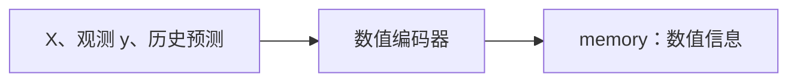
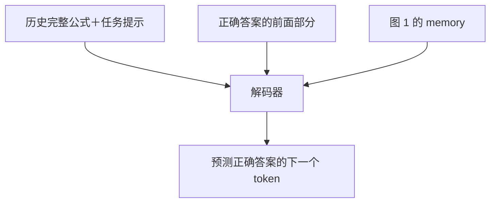
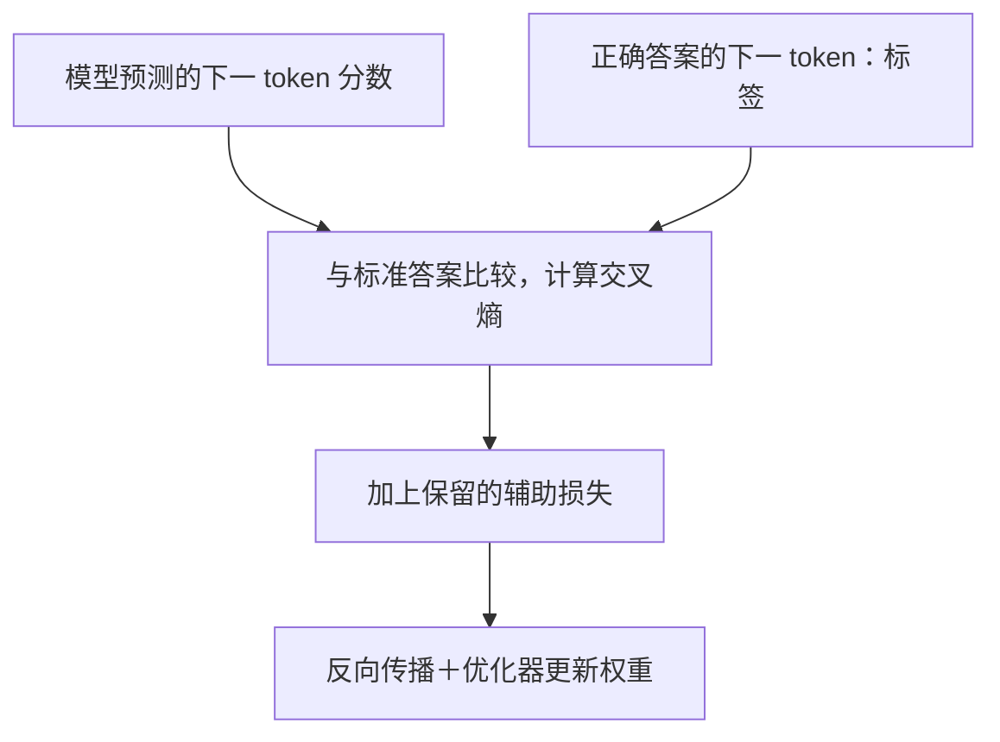
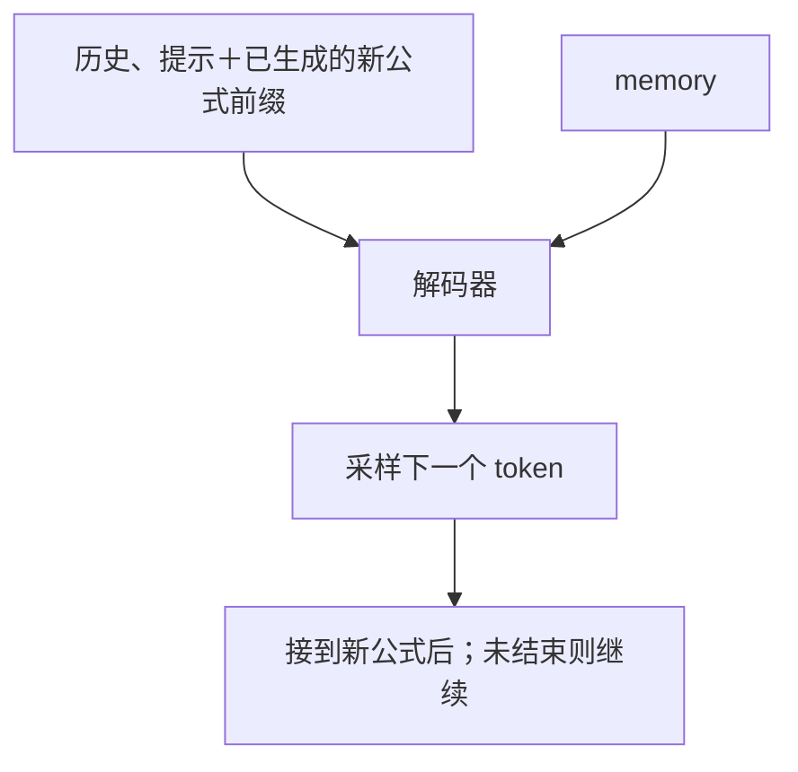
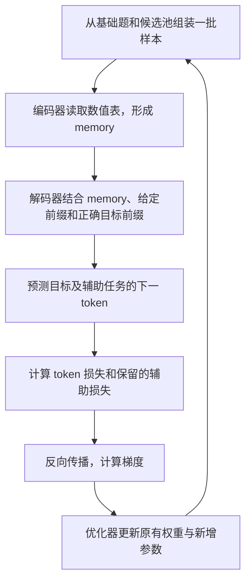

# 历史候选收益实验设计

日期：2026-11-18；统一更新：2026-11-20  
状态：实验设计，尚无结果；规模与预算中的建议值需经成本测量后确定。

## 文档分工与当前口径

**规模和实验安排以本文为准；模型输入、训练机制和推理原则沿用 [03 · 动机与问题](../../notes/03-推理精修动机与问题.md) 与 [04 · 精修设计](../../notes/04-推理精修设计.md)。** 本次只统一本文，不修改其他笔记，也不表示实现或实验已经完成。

- **规模不变**：200 题工程试跑；正式起点为 10,000 道训练题、1,000 道验证题；每题每组 300 次候选采样尝试；第一版 K=1；有效 batch 128；每组 10,000 次更新。完整设置以 §3.1 为准，04 §3.7 的 1M steps 不作为本轮预算。
- **细节沿用 03、04**：同一模型兼容 K=0/K>0；历史公式进入解码器前缀，历史预测进入数值编码器；历史不计算自身的预测 loss；推理生成只挖可拟合常数的结构，再拟合常数、合并两阶段候选。
- **04 中的方案选择**：第一版采用 §4.2b 推荐的“预测值拼列”。§4.2 的分别编码及其段编码、变长 memory 清单属于备选方案，不叠加到第一版实现中。
- **实验假设保持开放**：03 提出的随机历史与真实模型历史之差由本文 B/C 对照检验。04 中关于随机历史可能无用、模型历史更有价值的直觉不作为既定结果；本文不新增混合历史训练组。

## 0. 从头理解：我们怎样训练这个模型？

**训练方法是“扩展输入结构后的全参数监督微调”：从 T8-3M 预训练权重出发，让模型继续练习独立生成，同时学会参考历史候选生成。** 本节把后面的设计串成完整流程；具体规模以 §3.1 为准，尚待落实的规则见 §2.4。

### 0.1 最终训练出什么能力？

同一个模型接收两种形式的题目：

| 情况 | 模型看到什么 | 要做什么 |
|---|---|---|
| K=0，无历史 | X、观测 y | 独立生成公式 |
| K=1，有一个历史候选 | X、观测 y、历史公式、历史预测值 | 参考已有结果，生成新的公式 |

X 是输入点组成的表，y 是每行对应的观测输出；K 是送入模型的历史候选数，不是此前生成的候选总数。第一版只做 K=0/K=1，后续扩展另行验证。

模型学习生成一条完整的新表达式，不要求只修改历史中的局部，也不保证新表达式一定更好。训练后仍需拟合常数和比较候选。

### 0.2 从原始权重开始，增加两路历史输入

以现有 T8-3M 为共同权重来源，建立启用 T8.1 修复、支持历史输入的模型：兼容参数从旧模型加载，新增参数初始化一次，保存共同的 step-0 checkpoint，再复制给 A/B/C。具体迁移要求见 §3.2。

下面分三步看训练，每张图只说明一件事。**历史公式是参考；正确答案公式才是监督目标。**

#### 图 1：数值表怎样进入模型？

先把历史公式代入本题 X，算出预测值，再按行与 X、观测 y 拼接。



这里的编码器包含数值预编码和 Set Transformer。**正确答案公式不进入这张数值表。**

#### 图 2：解码器读取什么，预测什么？

下面只画一个目标预测位置。正确答案先按四种写法之一处理并转成 token；该位置只能读取其中已经排在前面的部分。



历史和正确答案前面的 token 先经过 embedding 变成向量，再由解码器自注意力读取；memory 通过交叉注意力读取。为避免图中重复连线，这两个处理细节用文字说明。

假设历史等给定内容记作 P，正确目标简写为 `t1 t2 t3 结束`：

| 预测位置能读取的公式内容 | 应该预测什么 |
|---|---|
| P | 正确答案的 t1 |
| P、t1 | 正确答案的 t2 |
| P、t1、t2 | 正确答案的 t3 |
| P、t1、t2、t3 | 结束标记 |

这些位置在训练时可以并行计算。因果遮罩保证每个位置看不到自己要预测的 token 和未来内容，不能直接复制答案。

#### 图 3：正确答案怎样用于评分和更新？



**正确答案的两种用途现在分别在图 2 和图 3 中：前面部分供模型读取，下一个 token 用来评分。** 实现时把完整训练序列错开一位：输入去掉最后一个 token，标签去掉第一个 token，再对齐预测位置。

历史、给定提示和填充位置不计算自身预测 loss；目标中需要模型作答的位置参与损失。历史仍可通过影响目标预测参与梯度计算。保留的辅助项包括原有辅助任务监督、异常点分类损失及 z-loss，详见 §0.6；不是对历史公式本身评分。

#### 推理时：用自己生成的前缀替换正确答案前缀

推理不提供正确答案，也不计算训练损失。数值编码仍按图 1 进行，随后重复下面这一步：



第一次还没有新公式 token，只有历史、提示和目标开始标记。每次生成一个 token 后再继续，直到结束或达到生成限制；完整有效的候选进入常数拟合。默认 `fittable` 模式下，可拟合常数由占位符表示。

第一版数值侧采用预测值拼列，解码器侧把历史放在目标之前。目标 token 通过自注意力读取历史公式，通过交叉注意力读取 memory。K=0 时不提供历史公式，并把预测槽位标记为缺失，仍保留 X、y。

**当前计划不冻结原网络，也不使用 LoRA。** 原有可训练参数与新增参数一起学习；新建本轮的优化器和学习率调度器，不恢复原预训练优化器状态。这里的“利用历史”只是建立了可学习的输入通路，是否真正获益要靠同 checkpoint 的 K=0/K=1 对照检验。

### 0.3 先准备有答案的题，再准备参考候选

先由生成器选择真实公式 f、采样输入 X、计算干净输出，再按原配方加入观测噪声。保存每道题的 X、观测 y 和真实公式。真实公式是训练答案，观测 y 是模型实际读取的数值条件。

接着为每道题准备两种候选池：

- **随机历史池**：随机生成结构，在本题 X、观测 y 上拟合常数。
- **模型历史池**：冻结的原始 T8 对本题采样，再在同一观测数据上拟合常数。

每个候选都保存拟合后的完整公式，以及它在本题相同 X 上算出的预测。候选可以错误，不能把池中“当前最好”的候选自动当成正确答案。常数拟合不能使用干净真值或留出数据。

下面是仅用于解释输入的无噪声示例，不是一次实际候选拟合记录：

```text
真实公式：2x² + 1
X：       0、1、2
观测 y：  1、3、9

假设历史公式：1.8x² + 0.9
对应历史预测：0.9、2.7、8.1
```

### 0.4 三个实验组怎样使用这些题？

A/B/C 是三个训练实验组，不是单个模型内部的三个模块。它们使用共同起点、共同基础题目和匹配预算：

| 组别 | 每次呈现题目时如何组织输入 | 目的 |
|---|---|---|
| A | 全部 K=0 | 测量只继续训练带来的变化 |
| B | 预定一半 K=0，一半配随机历史 K=1 | 检验随机历史训练的价值 |
| C | 预定一半 K=0，一半配模型历史 K=1 | 检验真实模型历史训练的价值 |

B、C 的 K=0 是继续练习原有独立生成能力，降低只学习带历史任务导致旧能力退步的风险，也使无历史评测属于训练覆盖的输入形式。50% 是本轮起点，不是已证明的最优比例。

K=0 任务是原模型学过的任务类型，不要求每条训练公式结构都从未在预训练出现过；但验证和测试必须与本轮训练题隔离，不能用记住的训练题证明泛化。新随机种子也不能保证与未知的原预训练样本完全无重叠。

### 0.5 一条样本的历史与正确答案分别怎么写？

```text
数值条件：X、观测 y、历史预测值
给定前缀：任务提示＋历史完整公式＋目标开始标记
监督目标：真实公式按本次抽到的答案写法表示
```

历史保留拟合后的具体常数，目标则沿用原模型的完整公式、全部常数挖空、只挖可拟合常数、部分常数挖空四种写法。例如同一个真实公式的目标可以是 `2x² + 1`，也可以是 `C₁x² + C₂`；这里 C 是便于阅读的占位符简写。

本轮不同时调整答案配比，避免把历史输入的作用与答案配方变化混在一起。辅助任务继续按原规则构造和监督，历史 token 不计算自身的预测 loss。具体协议见 §2.2。

### 0.6 一次参数更新怎样进行？



训练使用 teacher forcing：每个位置根据正确的先前 token 预测下一个 token，因果遮罩禁止偷看未来答案。推理时没有正确目标，改为接着自己生成的 token 继续写。

主要损失看正确 token 的概率：概率越低，交叉熵惩罚越大；它不是简单计算猜对比例，也不是先生成整条公式再按数值误差做强化学习。沿用的总损失为：

```text
总损失 = token 交叉熵 + 0.05 × 异常点分类损失 + 0.0001 × z-loss
```

历史不计自身预测损失，但目标预测依赖历史时，梯度仍可经过这条计算路径更新参数。异常点分类与 z-loss 分别提供逐点异常监督和输出分数尺度约束。

一个有效 batch 包含 128 道题。显存不足时可分小批累积梯度，累计到相同有效 batch 再更新。每组 10,000 次更新对应 1,280,000 次样本呈现；基础训练题只有 10,000 道，会重复使用，历史选择、答案写法和辅助任务可随呈现变化。组合变化不等于新增独立题目。

### 0.7 训练、常数拟合和推理精修不是同一种更新

| 操作 | 更新对象 |
|---|---|
| 本轮监督微调 | 神经网络权重 |
| 对候选做常数拟合 | 当前公式里的可拟合系数 |
| 推理精修循环 | 候选集合；网络权重保持固定 |

推理使用 `fittable` 模式生成结构，再拟合常数。受控实验先让各组共用冻结旧模型生成的第一阶段池；第二阶段分别使用训练后的模型，最后合并新旧候选。随后再验证更新后的同一个模型完成独立生成和精修的完整流程。

评价时既看候选中是否存在成功答案（Oracle），也看实际排序的第一名是否成功（Top-1）。同 checkpoint 的有历史/无历史比较回答“历史有没有用”；B/C 接收完全相同模型历史的比较回答“随机历史训练能否替代模型历史训练”。完整评测见 §4–§8。

### 0.8 实际推进顺序

先做 200 题工程试跑，核对公式与预测配对、历史和目标损失遮罩、K=0/K=1 输入、梯度数值、生成解析与常数拟合，并测量长度、显存、速度及失败比例。小试不以证明精修有效为通过条件。

落实 §2.4 的未定规则后，再扩到 10,000 道训练题、1,000 道验证题，运行三组各 10,000 步的训练，每 1,000 步保存和验证。最终固定评测设置，再报告同 draws 与等推理计算预算的结果。当前文档说明的是这套计划，不表示精修训练链路已经跑通。

## 1. 实验目的

验证精修模型是否能利用历史候选，在相同生成预算下，比继续独立采样找到更多正确表达式；进一步判断模型生成的历史是否比随机生成的历史更有帮助。

重点回答：

1. 提供历史是否带来额外收益？
2. 模型候选历史是否优于随机候选历史？
3. 第一阶段尚未解出的题，第二阶段能否修正错误、找到正确答案？
4. 第一阶段已经解出的题，第二阶段会生成什么，最终排序是否仍能选中好答案？

“已解出 / 尚未解出”是实验结果的交叉分析维度，不是额外的训练组。

### 1.1 待验证的假设与结论边界

以下均为待验证假设，不是已有结论。区分训练历史来源与评测历史来源：用随机历史训练的模型，也可以在推理时接收真实模型历史。

| 假设 | 对应比较 | 能支持的结论 |
|---|---|---|
| H1：整个精修方案优于原方案 | 原始模型独立采样 vs. 训练后模型的两阶段流程，总候选预算一致并另报计算成本 | 整体方案有收益，但不能单独归因于历史输入 |
| H2：推理时历史提供额外收益 | 同一个训练后 checkpoint、同题、相同第二阶段预算，比较 K=0 与正常历史 K>0 | 该模型有效利用历史输入；重点看第一阶段未解出题的新增解出率 |
| H3：随机历史训练方案优于不带历史训练 | B 与 A 使用匹配训练预算，按明确的评测输入比较 | 随机历史训练方案有效；仍需 H2 区分权重改善和推理时历史贡献 |
| H4：随机历史可替代昂贵的模型历史用于训练 | B、C 在评测时接收完全相同的真实模型历史 | 在效果接近且数据准备成本更低时，支持随机历史作为更经济的训练数据来源 |
| H5：历史内容及对应关系影响收益 | 固定 checkpoint，替换历史为另一组合法候选并在本题 X 上求值；可选打乱公式与 ŷ 对应关系 | 提供模型依赖历史内容的辅助证据，不能仅凭异常输入下退化下结论 |

H4 的“效果接近”应预先确定可接受的差距，并结合配对结果及不确定性判断；一次实验未观察到显著差异，不等于证明两者等效。成本包括候选结构生成、模型采样、常数拟合、求值与存储，随机结构仍需拟合，不能预设成本一定很低。

### 1.2 为什么需要同一模型的 K=0 对照

“原始模型无历史”与“训练后模型有历史”的比较，同时改变了权重、训练经历和推理输入，因此能验证整体方案，却不能分辨提升来自哪里。下面是假设数字，仅用于解释，非实验结果：

| 情况 | 原始模型，无历史 | 训练后模型，无历史 | 同一训练后模型，有历史 |
|---|---:|---:|---:|
| 大部分提升在去掉历史后仍存在 | 40% | 49% | 50% |
| 提供历史后提升明显 | 40% | 41% | 50% |

只看第一列和第三列，两种情况完全相同。补测中间一列，才能估计该 checkpoint 在推理时获得历史的额外收益；不能把这些差值进一步解释为训练因素之间严格可加的因果分解。

B、C 训练时混入 K=0，使无历史评测也是熟悉的输入形式。K=0 保留 X、y，不等于 condition dropout 的无数值条件输入。历史公式与预测值应一起移除，并正确设置缺失历史 mask。

同 checkpoint 的 K=0 评测无需额外训练模型，且不能由训练组 A 替代；A 的权重不同，承担的是训练配方对照。固定模型的比较提供历史有效利用的实验证据，不是数学证明，也不意味着每道题都受益。

## 2. 三个训练对照组

| 组别 | 训练时的历史 | 目的 |
|---|---|---|
| A：不带历史 | K=0，只输入 X、y | 控制继续训练本身带来的收益 |
| B：随机候选历史 | 随机生成结构，在本题观测数据上拟合常数，再提供公式及预测值 | 检验一般候选参考的作用 |
| C：模型候选历史 | 旧模型对本题采样并拟合常数，再提供公式及预测值 | 检验真实模型历史的作用 |

尽量使用相同的初始 checkpoint、基础题目、训练样本呈现次数、优化配置和答案写法配比。B、C 使用相同 K、历史输入结构、候选选择规则及 K=0 混合比例；A 全部使用 K=0。统一模型架构与缺失历史表示，减少架构差异造成的干扰。

B、C 的候选均在本题相同的 X 上计算预测值，常数拟合只使用观测 y，不使用干净答案。随机生成结构也有常数拟合成本，需要单独统计。随机候选不保证较差，模型候选也不预设为更好，需报告实际质量分布。

训练答案仍由题目生成器提供，沿用完整公式、全部常数挖空、只挖可拟合常数、部分挖空的原有抽样规则。历史公式保留拟合后的完整常数，不对历史自身计算预测 loss；原辅助任务中需要预测的答案仍按原规则监督。

**明确约定：精修训练样本的正确答案沿用原模型的四种答案生成方式及原有抽样配比，即完整正确公式、所有常数挖空、只挖可拟合常数、随机部分常数挖空。随机历史组与模型历史组均遵守这一约定，本实验不另改答案侧配方。** 这里的四种方式指同一个生成器正确公式的不同监督写法，具体规则见 [07 · 原模型的训练样本](../../notes/07-训练样本格式.md#2-原模型的训练样本)。

上述三组比较的是训练与历史来源组成的整体方案。为进一步检验同一模型是否利用历史，还需给 B、C 各做一次 K=0 的评测对照；解释时同时考虑去掉历史造成的输入变化，不能把组间差异全部归因于候选质量。

### 2.1 两路历史输入：沿用 04 §2、§4.2b

一条历史同时提供“公式怎么写”和“在当前题目上预测了什么”，两者必须一一对应：

```text
历史公式 τk（保留拟合后的常数） → token 序列 → 解码器的给定前缀
历史预测 ŷk = τk(X)            → 与 X、观测 y 按行拼列 → 编码器 → memory
                                                                      ↓
                                               解码器生成新的目标公式
```

第一版 K=1，每个点逻辑上是 `(x_i, y_i, ŷ_i)`。实际模型保留原有 17 个变量位置和 1 个 y 位置，再增加 1 个历史预测位置；输入层需要适配新增列。编码一次得到固定长度 memory，不采用分别编码各候选后拼接 memory 的方案。K=0 时历史公式不进入前缀，数值侧的历史槽位标记为缺失，X、y 仍保留；缺失历史不能仅靠零值与有效的零预测混淆。

当前只使用预测值。04 §4.4 和 03 §4.3 的加性/乘性残差属于后续可选研究，不在第一版额外加入。历史公式只能引用本题可用变量，并使用与 X、y 一致的坐标和预处理尺度。

### 2.2 前缀、答案与 loss：沿用 04 §2.2–2.3

下面展示逻辑区域；分隔符及任务标记的具体 token 协议仍需实现时核定，不能把示意中的 `<sep>` 当作现成词表项：

```text
给定前缀 P：[开始、输出要求等提示、历史完整公式、目标起始标记]
目标段 S：  [正确目标公式、目标结束标记、序列结束标记]
```

训练时使用正确目标前缀预测后续 token；推理时接着模型自己生成的目标 token 继续写。历史位于目标之前，目标通过因果自注意力读取历史，通过交叉注意力读取数值 memory。

- 历史前缀不计算自身的 token 预测 loss，但仍参与注意力，也可以通过目标损失接收梯度。
- 答案沿用本文 §2 的四种写法混合和原遮盖规则；历史始终保留拟合后的完整常数，答案侧遮盖不得误作用于历史。
- 损失遮罩必须与下一 token 标签正确移位，保留首个需预测目标及结束标记的监督；忽略值采用训练代码实际约定，04 中的 `-100` 只是示意。
- 原有辅助任务的答案继续按原规则监督；“不监督历史”不表示删除辅助任务的监督。

### 2.3 推理输出与结果复用：沿用 04 §5

第一版模型采样统一使用 `emission="fittable"`，即写法③：由模型直接输出可拟合常数占位符，保留按规则需要预测的指数等数值；随后由数值优化器拟合常数。训练中的四种答案写法混合不变，不要求推理随机切换四种写法。

按 04 §5 保存候选的规范化结构、拟合常数、观测误差、排序分、预测值与来源。第二阶段对同结构候选先查询已有结果，并记录跨阶段重复及缓存命中；新旧候选合并后按统一规则排名。复用键必须绑定当前题目的数据和拟合设置，不能仅凭结构跨题复用。

同结构不保证每次拟合结果相同。沿用 04 §5.4 的验证步骤：先测重复拟合的改善情况，再确定直接复用还是补充重启及其次数；所有对照采用相同政策，新增重启计入成本。不能预先假定复用对成功率无影响，也不能仅因 draws 相同而忽略拟合预算差异。

### 2.4 尚待落实的实现与评测规则

以下内容在 03、04 中尚未给出唯一可执行答案，本次不替它们编造已确定结论：

- 历史边界 token、输出要求标记的具体位置，以及目标提取协议；新增输入权重、缺失历史 mask 和旧权重加载的具体实现。
- 历史和目标合计过长时的处理，以及辅助任务剩余长度的分配；不得把公式截成不完整表达式或静默删除困难题。
- condition dropout 与历史条件的联动：K=0 仍有 X、y，不能代替无条件训练；需明确无条件分支是否及如何移除历史。
- 同结构复用和补充拟合政策、统一排序配置、验证选 checkpoint 的规则、配对置信区间计算方法，以及 H4“效果接近”的容许差距。

先在 200 题工程试跑中落实实现和测量成本；正式对照前冻结上述规则并保存配置，不在看到最终测试结果后更改。

## 3. 数据准备与小规模起步

### 3.1 第一版共同配置（2026-11-18 建议稿）

本表把第一轮实验收敛为一套具体起点，不表示已实现或已启动。先完成 200 题工程试跑并测量成本；若需调整预算，B、C 一起调整并记录版本，不单独扩大较便宜的一组。

| 项目 | B：随机历史与 C：模型历史的共同设置 |
|---|---|
| 基础训练题 | 10,000 道；共用同一份题目清单、X、y_noisy、正确公式和噪声实例，不只是同分布 |
| 验证题 | 1,000 道独立题，两组共用；最终测试沿用已有 test |
| 题目来源 | `configs/v25.0-T8.1-3M` 的 catalog 与 sampling；训练/验证使用不同数据 seed 并检查题目重叠 |
| 候选生成预算 | 每题每组 300 次结构/表达式采样尝试；随机组不无限重试到凑满有效候选，另报有效率和实际拟合数 |
| 候选存储 | 按骨架去重，每题最多 16 个；第一版统一按观测 FVU 升序保留，记录原始 score；随机候选没有模型 log_prob，不拿虚构的概率分数排序 |
| 历史选择 | K=1；从保留池前 min(10, 实际数量) 个候选中均匀抽取；相同规则应用到两种来源；空池回退 K=0 并报告比例 |
| 常数拟合 | 两组使用相同优化器、初始化分布、重启数与容差；起点为当前 8 次重启，正式运行时展开保存全部配置 |
| K=0 配比 | 预定 50% K=0、50% K=1，使用相同分支抽样序列；空池导致的额外 K=0 单独统计 |
| 基础题调度 | 第一轮所有样本均从共同的 10,000 题抽取，B、C 共用题目顺序、答案写法与辅助任务抽样计划；暂不为某一组额外引入在线新题 |
| 有效 batch size | 128；显存不足时可累积梯度，两组保持有效 batch 与更新数一致 |
| 训练预算 | 每组 10,000 次参数更新，即 1,280,000 次样本呈现；并非 128 万道独立题，更不是立即训练一亿次 |
| 复用量 | 均匀抽题时平均每题呈现 128 次，其中预定约 64 次带历史；需观察过拟合，不把这个复用量视为已验证合理 |
| 优化配置 | 以 T8.1 的 AdaMuon + AdamW 和损失配置为起点；学习率计划按 10,000 步重设：0→100 步 warmup 至 1e-4，保持至 8,000 步，降至 10,000 步为 0；这是待小试验证的微调起点 |
| 保存与验证 | 每 1,000 步保存与验证；报告末步和统一验证规则选出的 checkpoint，避免各组事后挑有利口径 |
| 独立训练次数 | 第一轮每组 1 次，配对使用相同训练 seed；确认值得扩大后，每组共做 3 个训练 seed；训练 seed 与已有 baseline 的推理 seed 是不同概念 |
| 答案与任务 | 两组沿用相同原答案写法混合、辅助任务、长度处理与 loss 规则 |

若运行训练对照 A，同样使用共同基础题目、初始化、10,000 次更新和优化配置，只将历史统一设为缺失。候选不足、长序列等处理不得使某一组静默换成另一批更容易的题。

相同规模首先指相同基础题目数、样本呈现次数、更新数和 K；不要求有效候选数、总 token 数或计算耗时恰好相同。这些差异必须记录，尤其候选生成成本正是 H4 要比较的结果之一。

### 3.2 初始权重与 T8 / T8.1 的区别

已核对当前代码：`experiments/baseline_scaling/run_baseline.py` 和 `experiments/candidate_pool/build_pool.py` 使用的都是 `psaegert/flash-ansr-v25.0-T8-3M`；本地 `models/psaegert/` 下发现的也是该模型。当前尚未确认有可用的预训练 T8.1 checkpoint。

T8.1 是新训练的配置起点，相比 T8 启用 `encoder_mask_query_norms=true` 和 `sanitize_input_num=true` 两项修复。“采用 T8.1 配置”不等于“已经加载 T8.1 预训练权重”，也不意味着必须从随机权重重新预训练。

第一版拟采用以下初始化方式：

1. 以现有 T8-3M 权重作为共同预训练来源，固定实际文件路径与哈希；其精确训练步数以 checkpoint 元数据或来源记录为准，不能仅凭配置的 150 万步宣称已跑满。
2. 建立启用 T8.1 修复、支持历史输入的模型，将兼容的 T8 权重迁移进去；新增输入权重或 token 等仅初始化一次，保存共同的 step-0 checkpoint，再复制给 A/B/C。
3. 为本次实验新建 optimizer 和 scheduler，从实验 step 0 开始；这是权重初始化后的新训练，不是恢复原预训练的 optimizer 状态。
4. 在训练前验证加载结果、迁移后 K=0 行为与数值稳定性，记录修复及新增结构造成的起点变化。加载适配尚待实现，不能直接假定旧 checkpoint 可无修改恢复。

冻结的原始 T8 继续承担候选池生成与已有 baseline 的角色，不为建池擅自开启 T8.1 修复。训练后 A/B/C 则统一使用 T8.1 修复及同一扩展架构。

### 3.3 扩容与数据管理

采用“离线保存题目及候选，训练时动态组装样本”的第一版方案。一道题只保存一个候选池，不为不同 K 保存多个池，也不预先展开所有候选组合。

按 §3.1 先完成 200 题工程试跑，再推进 10,000 道训练题与 1,000 道验证题。第一版 K=1，验证有效后再扩到 K=2、5；扩展 K 还需要解决序列长度和模型输入容量，不能仅靠池里保存更多候选。

训练题与验证题先划分，再生成候选和组装样本。同一道题的不同历史组合不能跨两个集合。固定池中的 X、观测 y 与正确公式；重新采 X 或加噪声属于新观测题，不能默认复用旧候选仍代表其第一阶段输出。

原训练已有验证数据入口，可为独立验证题补充候选。现有 test dataset 用于最终评测；不把最终测试结果反复用于选 checkpoint、调 K 或决定训练规模。若已据某测试集调整方案，应如实说明其开发用途。

池子按分片追加，记录模型版本、生成配置、seed、唯一题目 ID 和格式版本，支持后续扩容。若训练效果改善但验证效果停滞，可增加独立题目；若训练和验证都没有收益，应先检查实现、输入和候选质量，不能认定扩池一定有效。

一亿次训练样本呈现不等于一亿道独立题目。分别记录独立题目数、累计样本次数及每题复用次数，避免把组合多样性当作新题多样性。

### 3.4 是否需要保存候选池：补充证据与对照

第一版离线保存候选池是便于复现的工程起点，不表示已证明长期保存最划算。本轮补充证据，回答是否值得持久保存、保存哪些字段、保留多少候选。区分两类用途：**训练历史池**供多次样本呈现复用；**推理候选缓存**供同题跨阶段去重和拟合复用。推理缓存命中不能直接证明训练池值得持久保存；推理时暂存候选以合并排序，也不等于必须长期落盘。

新增记录：

- **存储量**：每题及全池实际大小，分别统计结构与常数、预测值和元数据的占用，记录压缩方式与格式版本。
- **读写成本**：建池写入、首次冷读、后续读取、反序列化、预测值重算耗时，以及训练等待数据的时间和峰值内存。
- **实际复用**：每个候选被训练选用的次数、未使用候选比例、跨训练轮次及重复实验的复用次数；推理缓存命中单独统计。
- **重建成本**：结构生成或模型采样、常数拟合、求值的耗时与失败率，以及获得相同规模有效历史所需的实际工作量。

先在200题工程试跑中比较以下方式，使用共同题目、相同历史选择和拟合规则，固定随机种子以尽量匹配候选内容：

| 方式 | 保存内容 | 主要比较 |
|---|---|---|
| 完整保存 | 结构、拟合常数、历史预测及必要元数据 | 建池、存储、读取总成本 |
| 精简保存 | 结构、拟合常数及可复现元数据；使用时重算预测 | 节省的空间与新增求值成本 |
| 不持久保存 | 使用时重新生成并拟合历史 | 重建成本、数据等待与峰值内存 |

明确各方式的内存缓存范围和生命周期，记录实际生成与复用次数，不把“不落盘但一直驻留内存”视为“每次重新生成”。固定候选内容的对照主要回答存取成本问题；若每次生成新历史，会同时改变训练数据多样性，须单独标注，不能把效果差异只归因于是否保存。工程计时不要求额外完成三套正式训练；若拟采用的新历史策略改变训练分布，再补充匹配预算的训练效果验证。

按实际使用次数，比较“首次建池＋写入＋多次读取／重算”与“不保存时重复生成、拟合、求值”的累计成本，报告测量环境、计时边界和保存开始划算的复用次数。结合候选使用分布评估保留数量；删减若改变历史选择分布，须经验证集检查后采用。最终提出完整保存、精简保存或按需重建的建议，注明适用规模与证据限制，不预设结论。

## 4. 受控评测流程

### 4.1 固定共同的第一阶段

先用冻结的旧模型，在相同评测题、数据 seed、拟合 seed 和预算下生成第一阶段候选池，并缓存结果。三个组共用这一初始池和初始状态划分。

第二阶段使用各组训练后的模型，生成相同数量的新候选。首先做与训练历史来源匹配的评测：

- A：只给 X、y，继续独立采样。
- B：给 X、y，以及为该题另行生成并拟合的随机历史候选。
- C：给 X、y，以及从共同第一阶段池中选出的模型历史候选。

此外必须区分两项补充比较：

- **历史输入收益（H2）**：B、C 分别固定自己的 checkpoint，与自身 K=0 比较。每次明确记录正常历史来自随机候选还是模型候选。
- **低成本训练替代（H4）**：B 和 C 都接收共同第一阶段池中选出的完全相同的 K 个模型候选及其 ŷ。此时只比较训练来源不同，不再同时更换推理历史来源。B 在这种输入上的表现也是随机历史训练向真实推理条件迁移的检验。

按训练来源和评测历史来源分别记录实验条件，不把 B 的两种评测混成同一个结果。

历史选择只使用推理时可获取的 score、观测误差等信息。干净答案上的误差仅用于评测和事后分组，不参与历史挑选。选择策略、K、候选不足时的回退规则需在正式实验前固定。

三个组最终均合并“共同第一阶段候选 + 本组第二阶段新候选”并排序。B 的随机历史在这个受控实验中仅作为输入，不额外加入最终候选集合，以保持最终候选集合的来源口径一致；其生成和拟合成本仍须计入报告。

该设计用于控制第一阶段差异，不等同于最终部署流程。验证收益后，再评测更新后的同一个模型完成“独立生成 → 精修”的完整流程，并可后续扩展多轮。

### 4.2 按第一阶段结果交叉分析

| 第一阶段状态 | 第二阶段重点观察 |
|---|---|
| 尚未解出：初始池没有成功候选 | 新增解出率、误差改善、是否产生新的正确结构 |
| 已经解出：初始池至少有一个成功候选 | 新输出是否正确、是否重复历史结构、合并后 Top-1 是否仍正确 |

另外记录“实际选出的 K 个历史中是否含成功候选”。初始池有答案，不代表模型看到了答案；B 的随机历史也要按其实际内容记录。

第一阶段分组在每个题目与 seed 的运行上定义，不用“任意一个 seed 曾解出”替代本次运行状态。

## 5. 成功标准与主要指标

沿用 baseline scaling 的成功标准：留出点 FVU ≤ float32 eps。这是数值成功标准，不等于符号等价。留出数据不参与候选生成、常数拟合或实际排序。

主要指标：

1. **新增解出率**：第一阶段未解出的题中，第二阶段至少产生一个成功候选的比例。明确报告分母和新增解出题数；分母为零时记为不适用。
2. **合并 Oracle 成功率**：两阶段合并后是否存在成功候选。
3. **合并 Top-1 成功率**：使用实际排序规则选出的第一名是否成功。
4. **第二阶段自身成功率**：只看新生成候选，不借助第一阶段旧答案。
5. **结构重复率与误差变化**：新候选与历史是否具有相同规范化结构，以及观测误差、留出误差如何变化。结构相同不必然代表完整公式相同或行为上照抄，还需检查常数和预测。

保留第一阶段候选意味着：合并 Oracle 成功不会因精修而丢失，这是存储流程的保证，不是模型能力。合并后的 Top-1 则可能变化，应单独检查由成功变失败的情况。

## 6. 每次运行需要保存的信息

| 类别 | 字段或内容 |
|---|---|
| 身份与配置 | problem_id、split、实验组、checkpoint、数据/采样/拟合 seed、训练数据版本、K、历史选择规则 |
| 第一阶段 | 候选 ID、结构、拟合常数、score、是否存在成功候选、最优误差、Top-1 是否成功 |
| 实际历史 | 来源、候选 ID 与顺序、拟合常数、预测值或可重算信息、误差、是否含成功候选 |
| 第二阶段 | 每个新候选、关联的历史组合、生成/拟合状态、score、观测与留出误差、是否成功 |
| 重复与变化 | 与历史及第一阶段池的结构重复情况、完整表达式重复情况、常数变化 |
| 最终结果 | 合并 Oracle、合并 Top-1、最终选中候选及其来源 |
| 预算与成本 | 两阶段 draws、有效/唯一候选数、拟合重启数、拟合次数、耗时、缓存命中、随机历史准备成本 |
| 候选池持久化（§3.4） | 各字段存储量、压缩与格式、写入／冷读／后续读取耗时、反序列化与预测重算耗时、数据等待、峰值内存、每候选使用次数、未使用比例、重建成本及缓存生命周期 |
| 异常 | 无有效候选、非有限预测、序列过长、拟合失败及回退行为 |

候选预测值列与公式顺序必须一致。候选不足时使用预先规定的缺失 mask 或 K=0 回退，不静默删除困难题。长序列不能截断成不完整公式，应记录并按明确策略处理。

## 7. 与已有 baseline scaling 的关系

已有 [三 seed 联合分析](../../runs/baseline_scaling/combined/analysis.md) 覆盖同一批 120 题、预算 50、100、300、500、700、1000、3000，是原模型独立采样的基线，可以复用，无需仅为本设计重复运行。

例如 300 次初始采样 + 700 次第二阶段生成，可对照已有的 1000 次独立采样。必须匹配题目、数据 seed、拟合设定和成功标准，并检查配置兼容性。

相同 draws 不等于相同实际计算量：历史前缀会增加解码成本，常数拟合与随机历史准备也产生额外开销。报告候选预算和计算成本两种口径；已有分析的 FLOPs 估算不含完整拟合成本，墙钟耗时也有已知限制，不据此直接宣称速度优势。

按 [03 §2](../../notes/03-推理精修动机与问题.md) 的要求，最终还需做**相同推理时间或计算预算**的对照；同 draws 加耗时报告不能替代这一比较。本文的 300+700 vs. 1000 用于候选数匹配的第一轮比较，不因此改动 §3.1 的训练规模。等计算预算评测在验证集测量后确定总预算及阶段分配，计入编码、历史选择、新增历史准备和常数拟合开销，再对各方案使用一致的计时边界。离线训练建池成本另列，不与单题推理时间混为一项。完成这项评测前，结论限定为“相同候选预算下的收益”，不宣称相同算力下更有效。


已有 baseline 不替代“继续训练后的模型 K=0”对照。前者回答是否超过原模型，后者帮助判断收益是否依赖历史。

## 8. 结果展示与执行顺序

主表同时标注训练组 A/B/C 与评测历史来源（无历史 / 随机历史 / 模型历史），展示整体 Oracle、Top-1、第二阶段自身成功率、第一阶段未解出子集的新增解出率，以及成本。分别汇总 H1 的整体方案对照、H2 的同 checkpoint 对照、H4 的同一真实历史对照，不混用解释。附表展示第一阶段已解出子集的结构重复、第二阶段成功和最终 Top-1 变化，并按实际历史是否含正确答案细分。

使用相同题目与 seed 做配对比较。多个 seed 重复同一题，不当作更多独立题目；同时报告题数、seed 数、分组分母和波动。

执行顺序：

1. 用随机历史跑通样本、mask、训练和评测链路，不要求随机历史必须先表现出收益。
2. 测量真实候选建池成本，完成小训练池及独立验证池；同步开展 §3.4 的完整保存、精简保存与不持久保存工程对照。
3. 完成三个组的受控实验，并同步记录上述交叉分析信息。
4. 在验证集上判断是否扩池、增加 K 或调整实现，并结合存储、读写、重建和实际复用证据，形成候选池保存策略建议。
5. 在验证集固定等推理时间/计算预算的评测设置；确定方案后，在现有 test 上报告同 draws 与等计算预算两种结果，并验证共享更新后模型的完整两阶段流程。

相关设计：[项目目标](../../notes/00-项目目标与整体思路.md)、[推理精修设计](../../notes/04-推理精修设计.md)、[候选池生成](../../notes/06-候选池生成.md)、[训练样本格式](../../notes/07-训练样本格式.md)。
